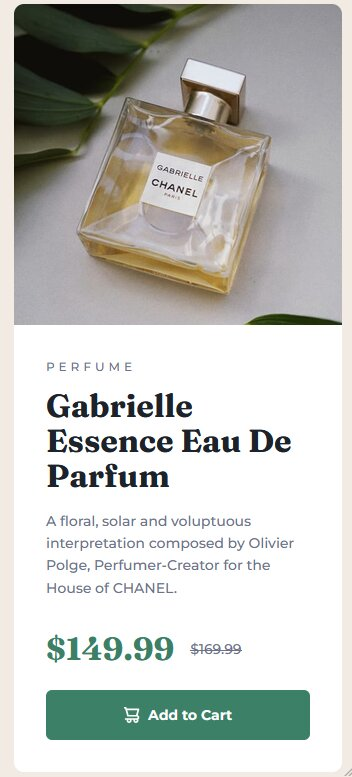

# Frontend Mentor - Product preview card component solution

This is a solution to the [Product preview card component challenge on Frontend Mentor](https://www.frontendmentor.io/learning-paths/building-responsive-layouts--z1qCXVqkD/challenge/65e71e1c17e502f0b6ce64b0/start). Frontend Mentor challenges help you improve your coding skills by building realistic projects.

## Table of contents

- [Overview](#overview)
  - [The challenge](#the-challenge)
  - [Screenshots](#screenshots)
- [My process](#my-process)
  - [Built with](#built-with)
  - [What I learned](#what-i-learned)
- [Author](#author)

## Overview

### The challenge

Users should be able to:

- View the optimal layout depending on their device's screen size
- See hover and focus states for interactive elements

### Screenshots

#### Desktop (1440px)


#### Mobile (375px)



## My process

### Built with

- Semantic HTML5 markup
- CSS custom properties (variables)
- Flexbox
- CSS Grid
- Mobile-first workflow
- Responsive images with the `<picture>` element
- Google Fonts (Montserrat, Fraunces)

### What I learned

- Swapping the image with `<picture>` and `<source media="(min-width: 768px)">` only changes which file loads. I had to add a CSS media query that switches the card from `flex-direction: column` to `row` depending on the screen size:

```css
@media (min-width: 768px) {
  .product-card {
    flex-direction: row;
  }

  .product-card picture,
  .card-content {
    flex: 1;
  }
}
```

- Buttons don't inherit `font-family` from the page by default. Adding `font-family: inherit` to the button made it use Montserrat like the rest of the card.

- An image that sits next to text that already describes it, like the cart icon in the "Add to Cart" button, is decorative. Giving it an empty `alt=""` stops screen readers from announcing it twice.

- Hover styles aren't enough for accessibility. Adding `:focus-visible` to the button gives keyboard users the same visual feedback. It is triggered by keyboard focus, like pressing the Tab key, or whenever the browser decides a visible focus indicator is needed:

```css
.add-to-cart:hover,
.add-to-cart:focus-visible {
  background-color: var(--green-700);
}
```

## Author

- GitHub - [@TeaJosh](https://github.com/TeaJosh)
