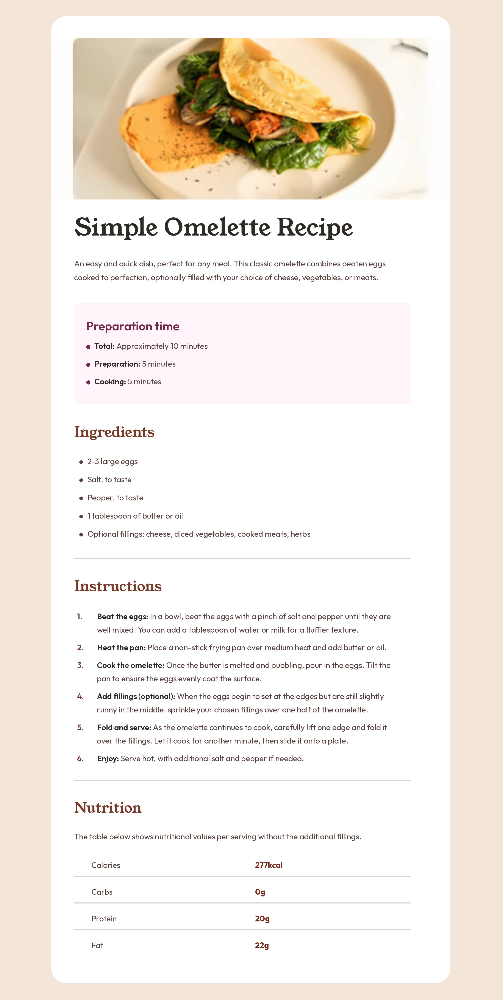

# Frontend Mentor - Recipe page solution

This is a solution to the [Recipe page challenge on Frontend Mentor](https://www.frontendmentor.io/challenges/recipe-page-KiTsR8QQKm). Frontend Mentor challenges help you improve your coding skills by building realistic projects.

## Table of contents

- [Overview](#overview)
  - [The challenge](#the-challenge)
  - [Screenshot](#screenshot)
- [My process](#my-process)
  - [Built with](#built-with)
  - [What I learned](#what-i-learned)
- [Author](#author)

## Overview

### The challenge

Build out the recipe page to match the design as closely as possible. The layout should be responsive, working from 320px up to large screens, with the design provided at 375px (mobile) and 1440px (desktop).

### Screenshot



## My process

### Built with

- Semantic HTML5 markup
- CSS custom properties (variables)
- Mobile-first workflow
- CSS Grid (to center the card on the page)
- Google Fonts (Outfit and Young Serif)

### What I learned

- **Keep the page padding on `main`.** I tried removing the 24px padding, but when I shrank the window the card hugged the screen edges.

- **`::marker` styles list markers separately from the text.** This let me color the bullets rose in the prep box and brown elsewhere, and bold the instruction numbers:

```css
li::marker {
  color: var(--brown-800);
}

.instructions li::marker {
  font-weight: 700;
}
```

- **`object-fit: cover` crops an image instead of stretching it.** Combined with a fixed `height`, it kept the omelette photo looking right at both sizes.

## Author

- GitHub - [@TeaJosh](https://github.com/TeaJosh)