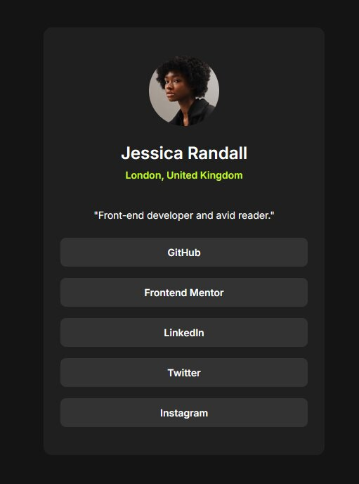

# Frontend Mentor - Social links profile solution

This is a solution to the [Social links profile challenge on Frontend Mentor](https://www.frontendmentor.io/learning-paths/getting-started-on-frontend-mentor-XJhRWRREZd/challenge/65e6f48617e502f0b6ca3d01/start). Frontend Mentor challenges help you improve your coding skills by building realistic projects.

## Table of contents

- [Overview](#overview)
  - [The challenge](#the-challenge)
  - [Screenshot](#screenshot)
- [My process](#my-process)
  - [Built with](#built-with)
  - [What I learned](#what-i-learned)
- [Author](#author)

## Overview

### The challenge

Users should be able to:

- See hover and focus states for all interactive elements on the page

### Screenshot



## My process

### Built with

- Semantic HTML5 markup
- CSS custom properties (variables)
- Flexbox
- CSS Grid
- Google Fonts (Inter)

### What I learned

- The `gap` property only works on a flex or grid container, not on the items inside it. The parent controls the spacing between its children. I had `gap` on the links themselves, so the buttons touched each other. Moving `display: flex`, `flex-direction: column`, and `gap` to the parent `<nav>` fixed it.

- Hover styles aren't enough for accessibility. Adding `:focus-visible` gives keyboard users the same visual feedback, and I paired it with a visible outline.

- Storing the style guide colors in `:root` custom properties makes them easy to reuse and change in one place:

```css
:root {
  --green: hsl(75, 94%, 57%);
  --grey-800: hsl(0, 0%, 12%);
}
```

## Author

- GitHub - [@TeaJosh](https://github.com/TeaJosh)